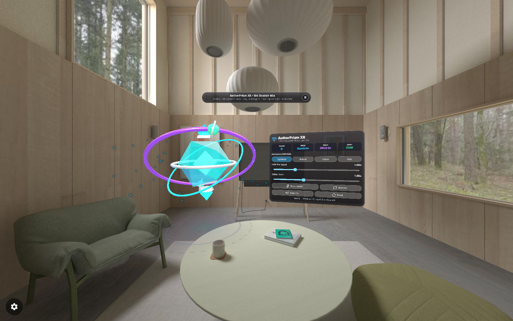
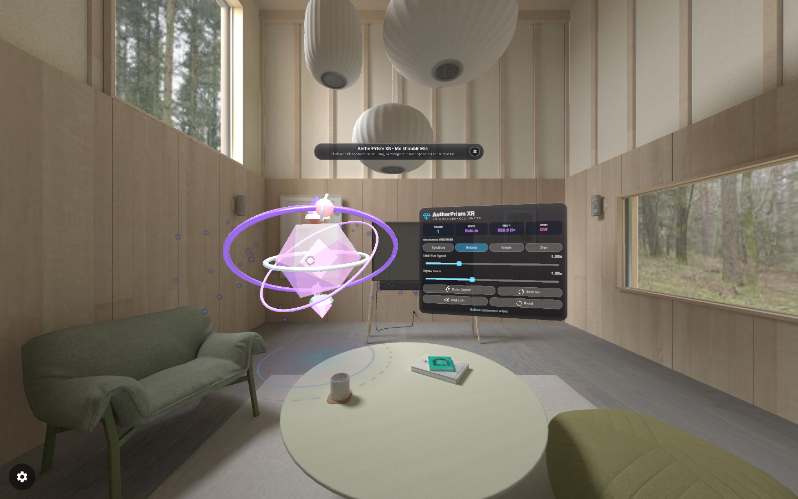
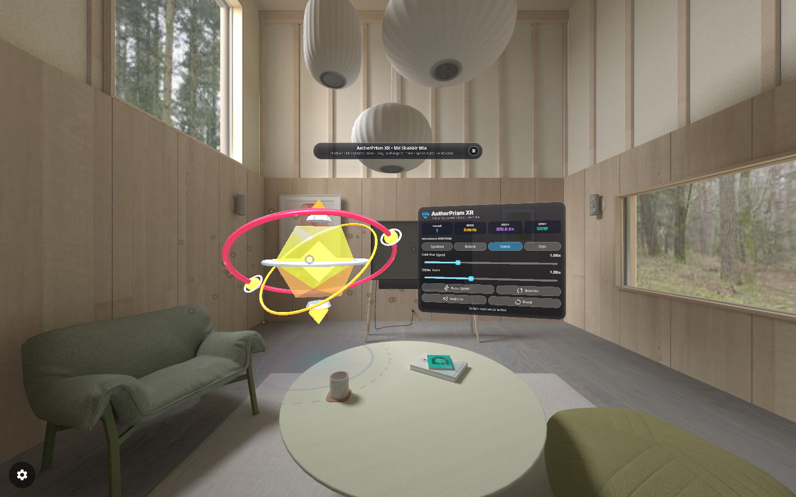
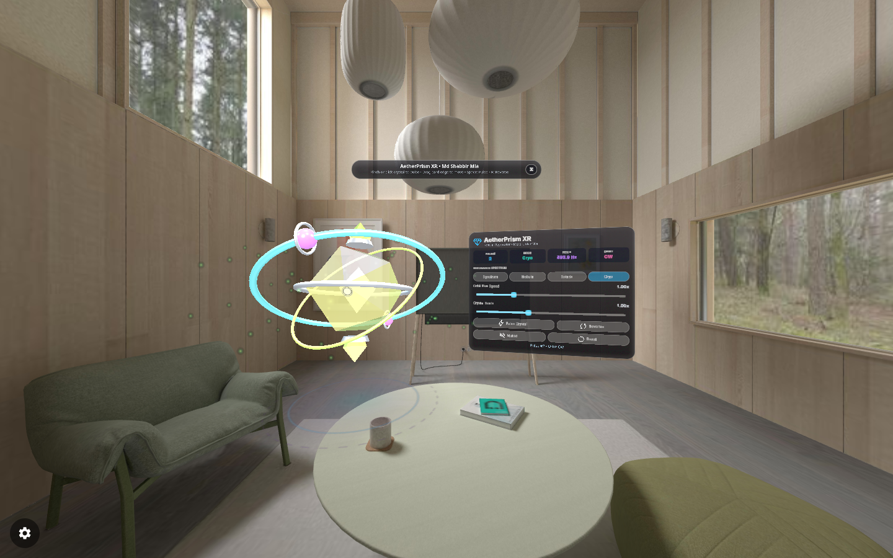
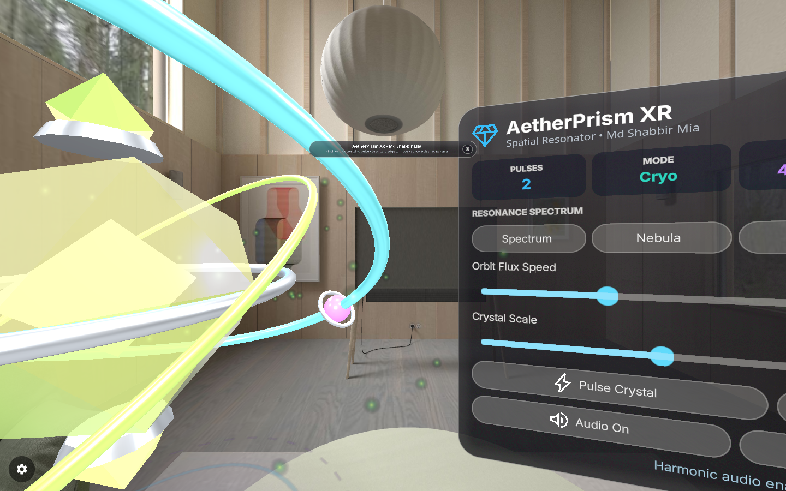

# AetherPrism XR — Spatial Crystal Resonator & Harmonic Orbit Lab

> **Authored & Maintained for:** **Md Shabbir Mia**  
> **Framework Stack:** **XR Blocks `~0.24.0`** • **Three.js `~0.186.0`** • **TypeScript (Strict Mode)** • **Vite `^8.3.0`** • **WebXR + Web Audio API**



**AetherPrism XR** is an enterprise-hardened, interactive WebXR spatial computing experience built using the **XR Blocks (`xb.Script`)** architecture and procedural **Three.js** PBR rendering. Floating inside your mixed-reality environment (or the built-in desktop WebXR simulator), a multi-part prismatic crystal core, dual counter-rotating orbital energy rings, gimballed satellite nodes, and a 56-particle starlight field respond in real time to **hand pinches, XR controller rays, mouse clicks, keyboard shortcuts, and an interactive Spatial UI control deck**—accompanied by zero-asset procedural pentatonic Web Audio crystal chimes.

---

## Table of Contents

1. [Visual Gallery & Feature Walkthrough](#visual-gallery--feature-walkthrough)
2. [Complete Features & Capabilities](#complete-features--capabilities)
3. [Technology Stack & Libraries Used](#technology-stack--libraries-used)
4. [System Architecture & Data Flow](#system-architecture--data-flow)
5. [Complete Code & File Map](#complete-code--file-map)
6. [Enterprise Security & Fault-Tolerance Hardening](#enterprise-security--fault-tolerance-hardening)
7. [Step-by-Step Setup & Run Guide](#step-by-step-setup--run-guide)
8. [Interactive Controls Reference (Desktop, Keyboard & XR Headsets)](#interactive-controls-reference-desktop-keyboard--xr-headsets)
9. [Verification, Automated Testing & Quality Gates](#verification-automated-testing--quality-gates)

---

## Visual Gallery & Feature Walkthrough

### 1. Default Launch — Spectrum Resonance Mode (`CCW` Orbit)

- **What is shown:** The initial state (`PULSES: 0`, `MODE: Spectrum`, `PITCH: 261.6 Hz`, `ORBIT: CCW`). The floating **Crystal Assembly** (`x: -0.42m, y: 1.44m, z: -1.32m`) sits symmetrically opposite the interactive **Spatial HUD Card** (`x: +0.46m, y: 1.44m, z: -1.28m`) with a top-centered **Status Overlay** (`top: 24px`) and exit button.

### 2. Crystal Click Pulse + Nebula Preset (`Pulses: 1`, `329.6 Hz`, `CW`)

- **What is shown:** Clicking or pinching directly on the 3D crystal increments `PULSES` from `0` to `1`, reverses orbit rotation to clockwise (`CW`), triggers a spring-physics scale impulse + core emissive flash, plays a pentatonic harmonic chime, and (after switching to **Nebula**) transitions all 5 PBR material targets smoothly via exponential interpolation (`1 - exp(-8 * dt)`). Notice the reticle dot locked cleanly onto the crystal cluster.

### 3. Reverse Orbit + Solaris Resonance Mode (`CCW`, `370.0 Hz`)

- **What is shown:** Switching to **Solaris** (`Digit3` or Spatial UI button) and reversing orbit (`KeyR` or **Reverse** button) shifts the crystal shell, spires, plasma core, orbital rings, gimballed moons, and starlight dust into warm amber-gold and crimson tones while rotating counter-clockwise (`CCW`).

### 4. Cryo Resonance + Spacebar Pulse + Audio Toggle (`Pulses: 2`, `493.9 Hz`, `Muted`)

- **What is shown:** Pressing `KeyM` mutes the synthesizer (the Spatial UI button updates live to **Muted**), selecting **Cryo** shifts the palette to glacial cyan/teal, and pressing `Space` triggers Pulse #2—progressing both the golden-ratio hue shift (`customHue`) and the pentatonic frequency step up to `493.9 Hz`.

### 5. Close-Up Geometry, PBR Materials & Sharp MSDF Spatial UI

- **What is shown:** Up-close inspection highlights the multi-part procedural craftsmanship:
  - Faceted translucent `MeshPhysicalMaterial` outer icosahedron (`clearcoat: 1.0`, `iridescence: 0.9`, `flatShading: true`) illuminated by `RoomEnvironment` PMREM studio reflections
  - Glowing inner octahedron plasma core
  - Brushed titanium equatorial gyro bezel and polar collars (`metalness: 0.88`, `roughness: 0.34`)
  - Upper & lower 6-sided `LatheGeometry` crystal spires
  - Primary tilted energy ring carrying two gimballed satellite orbs + counter-rotating secondary ring
  - Crisp `@pmndrs/uikit` MSDF typography and interactive sliders inside `xb.UICard`

---

## Complete Features & Capabilities

- **Multi-Part Procedural 3D Crystal Assembly (`CrystalAssembly.ts`)**
  - **7 coordinated 3D sub-systems:** inner plasma octahedron, iridescent physical outer prism shell, titanium equatorial bezel & polar collars, upper/lower `LatheGeometry` spires, primary torus ring with 2 gimballed satellite nodes, secondary counter-rotating ring, procedural `CanvasTexture` radial projection base disc, and 56 orbital starlight dust points (`THREE.Points`).
  - **Damped Harmonic Spring Physics:** Ray hover gently inflates the crystal (`1.05x`), pointer press compresses (`0.91x`), and release/pulse launches an analytical damped spring bounce (`1.36x` -> `1.0x`) coupled with an exponential core flash decay.
  - **Zero-Allocation Render Loop:** Pre-allocated color temporaries (`_tmpColorA`, `_tmpColorB`) and static particle buffers keep per-frame GC pressure at zero.

- **Zero-Asset Procedural Pentatonic Web Audio Synthesizer (`AudioResonator.ts`)**
  - Synthesizes crystalline chimes in real time using layered `sine` fundamental + `triangle` shimmering fifth/octave overtones tuned to a **10-step Pentatonic Scale** (`261.6 Hz` base progressing across `[0, 2, 4, 7, 9, 12, 14, 16, 19, 24]` semitones).
  - Tactile UI click synthesis for Reverse, Mute, and Reset actions.
  - Automatic `AudioNode.onended` disconnection prevents audio graph memory leaks across unlimited pulses.

- **Interactive Spatial UI Deck (`SpatialHudCard.ts`) & Status Overlay (`StatusOverlay.ts`)**
  - Built strictly with XR Blocks native spatial controls: `xb.UICard` (`manipulation: true`, `edge: true` for grab/move/resize in 3D space), `xb.UIPanel`, `xb.UIText`, `xb.UIIcon`, `xb.UIButton`, `xb.UISlider`, `xb.UIOverlay`, and `xb.UIExitButton`.
  - **Live Telemetry Tiles:** `PULSES`, `MODE`, `PITCH` (`Hz`), and `ORBIT` (`CCW`/`CW`).
  - **Instant Resonance Presets:** `Spectrum`, `Nebula`, `Solaris`, and `Cryo`.
  - **Continuous Controls:** `Orbit Flux Speed` (`0.25x` – `3.00x`) and `Crystal Scale` (`0.70x` – `1.50x`) sliders.
  - **Validated Layout:** Self-checks via `xb.ui.validate(...)` with `0` layout errors (`uiValid: true`).

- **Universal Multi-Modal Input (`AetherPrismScene.ts` + `index.ts`)**
  - Works seamlessly with **WebXR Hand Tracking & Pinch**, **WebXR 6DoF Controllers**, **Desktop Mouse Raycasting**, and **Keyboard Shortcuts**.
  - Studio IBL reflections via Three.js `RoomEnvironment` + `PMREMGenerator` paired with a warm/cool 3-point directional/hemisphere light rig.

---

## Technology Stack & Libraries Used

| Component / Package | Version | Purpose in AetherPrism XR |
| :--- | :--- | :--- |
| **`xrblocks`** | `~0.24.0` | Core WebXR lifecycle (`xb.Script`, `xb.Options`), desktop WebXR Simulator, hand/controller raycasting, reticles, and `@pmndrs/uikit` Spatial UI (`UICard`, `UIOverlay`, `UIButton`, `UISlider`, `UIText`, `UIIcon`, `UIExitButton`). |
| **`three`** | `~0.186.0` | WebGL rendering engine, PBR materials (`MeshPhysicalMaterial`, `MeshStandardMaterial`), procedural geometries (`IcosahedronGeometry`, `OctahedronGeometry`, `TorusGeometry`, `LatheGeometry`, `CylinderGeometry`, `CircleGeometry`), `Points`, `CanvasTexture`, and `RoomEnvironment` PMREM lighting. |
| **`@pmndrs/uikit`** | `^1.0.64` | Yoga-powered flexbox 3D spatial layout and crisp MSDF text rendering (managed via XR Blocks). |
| **`@preact/signals-core`** | `^1.14.0` | Reactive signal primitives powering Spatial UI updates under the hood of XR Blocks. |
| **`lit`** | `^3.3.1` | Simulator settings panel & web component UI runtime used by XR Blocks Simulator. |
| **`typescript`** | `^7.0.2` | Strict static type checking (`"strict": true`, `tsc --noEmit`). |
| **`vite`** | `^8.3.0` | Fast ES module dev server (`0.0.0.0:3000`), production bundler (`npm run build`), and HTTP security headers (`vite.config.ts`). |
| **Web Audio API** | Browser Native | Zero-dependency dual-oscillator harmonic chime and UI click synthesis (`AudioResonator.ts`). |
| **Node Test Runner (`node:test`)** | Node `v22+` | Pure TypeScript unit & security/fault-injection test suite (`src/crystalState.test.ts`). |

---

## System Architecture & Data Flow

```text
+-------------------------------------------------------------------------+
|                            src/index.ts                                 |
|   Strict ?autostart Check • xb.Options (Hands, Gestures, Reticles)      |
|   XSS-Safe DOM Error Fallback • Launches xb.init(options)               |
+-----------------------------------+-------------------------------------+
                                    |
                                    v
+-------------------------------------------------------------------------+
|                      src/AetherPrismScene.ts (xb.Script)                |
|   • RoomEnvironment PMREM + 3-Point Rig   • WebGL Context Loss/Restore  |
|   • Keyboard Shortcuts (Space/R/M/1-4/0)  • Debounced xb.ui.validate()  |
|   • Holds authoritative immutable CrystalState                           |
+----+-----------------------+---------------------------+----------------+
     |                       |                           |
     | delegates pure        | drives visual             | syncs UI
     | state transitions     | targets & spring          | telemetry &
     v                       v                           v controls
+------------------+   +-----------------------+   +----------------------+
| src/crystalState |   | src/CrystalAssembly   |   | src/SpatialHudCard   |
| (Pure Functions) |   | (xb.Script 3D Rig)    |   | (xb.UICard + Edge)   |
| • Frozen Presets |   | • Inner Core + Shell  |   | • 4 Metric Tiles     |
| • NaN/Inf Guards |   | • Spires + Bezels     |   | • 4 Preset Buttons   |
| • Pentatonic Hz  |   | • 2 Rings + 2 Orbs    |   | • Speed/Scale Sliders|
| • Spring Solver  |   | • Particles + Emitter |   | • Action Buttons     |
+------------------+   +-----------------------+   +----------------------+
     |                                                   ^
     | frequencyHz + speedMultiplier                     |
     v                                                   |
+--------------------------+               +------------------------------+
| src/AudioResonator.ts    |               | src/StatusOverlay.ts         |
| • Web Audio Oscillators  |               | • Top xb.UIOverlay Banner    |
| • Clamped Hz & Gains     |               | • Inline xb.UIExitButton     |
| • onended Node Cleanup   |               +------------------------------+
+--------------------------+
```

---

## Complete Code & File Map

| Path | Role & Key Exports / Responsibilities |
| :--- | :--- |
| `/index.html` | HTML5 entry point with SEO/OpenGraph metadata, `X-Content-Type-Options: nosniff`, `referrer` policy, and module entry `/src/index.ts`. |
| `/metadata.json` | Applet identity (`name: "AetherPrism XR"`) and description synced with HTML metadata. |
| `/package.json` | Dependency manifest (`xrblocks`, `three`, `@pmndrs/uikit`, `lit`, `typescript`, `vite`) and scripts (`dev`, `build`, `preview`, `lint`). |
| `/tsconfig.json` | Strict TypeScript compiler configuration targeting `es2024` / `es2022` modules. |
| `/vite.config.ts` | Vite server & preview configuration (`0.0.0.0:3000`), WebXR-compatible HTTP security headers, and `build.sourcemap: false`. |
| `/src/index.ts` | Application bootstrap: validates `?autostart`, enables XR Blocks hands/gestures/reticles, registers `AetherPrismScene`, and provides an `innerHTML`-free safe error fallback. |
| `/src/index.css` | Styles for the full-screen canvas, `#XRButtonWrapper`, `.XRButton`, and `.XRButtonError` fallback banner. |
| `/src/bg.svg` | Vector background displayed behind the entry UI prior to entering XR/Simulator. |
| `/src/crystalState.ts` | Pure, side-effect-free state engine: `RESONANCE_PRESETS` (frozen), `triggerCrystalPulse`, `selectPreset`, `toggleOrbitDirection`, `setOrbitSpeed`, `setCrystalScale`, `toggleAudioEnabled`, `resetCrystalState`, `computeHarmonicFrequency`, `stepSpringScale`, `isValidPresetId`, and `clampValue`. |
| `/src/crystalState.test.ts` | 6 automated `node:test` unit & security tests verifying state transitions, spring convergence, `NaN`/`Infinity` rejection, and prototype-pollution guards. |
| `/src/CrystalAssembly.ts` | Procedural multi-part 3D crystal & dual-ring satellite assembly extending `xb.Script`; handles `onHoverEnter`, `onHoverExit`, `onObjectSelectStart`, `onObjectSelectEnd`, spring animation, smooth color/emissive interpolation, and idempotent GPU resource `dispose()`. |
| `/src/SpatialHudCard.ts` | Floating, movable/resizable `xb.UICard` panel (`0.72m` wide) rendering live telemetry, preset selectors, sliders, and action buttons. |
| `/src/StatusOverlay.ts` | Top-center `xb.UIOverlay` displaying controls help, author branding, and an inline `xb.UIExitButton`. |
| `/src/AudioResonator.ts` | Web Audio API harmonic chime & tactile UI click synthesizer with finite parameter clamping and automatic node disconnection. |
| `/src/AetherPrismScene.ts` | Main scene `xb.Script`: configures `RoomEnvironment` PMREM + 3-point lights, prevents global double-pulse on crystal clicks, binds WebGL context-loss recovery + keyboard shortcuts, runs `xb.ui.validate()`, and tears down all resources in `dispose()`. |
| `/docs/images/*.png` | Verified real-browser screenshots embedded across this README (`01` through `05`). |

---

## Enterprise Security & Fault-Tolerance Hardening

To ensure zero runtime faults, memory leaks, or client-side security weaknesses:

1. **HTTP Security Headers (`vite.config.ts` & `index.html`)**
   - `X-Content-Type-Options: nosniff` prevents MIME-type sniffing attacks.
   - `Referrer-Policy: strict-origin-when-cross-origin` restricts cross-origin referrer leakage.
   - `X-Permitted-Cross-Domain-Policies: none` & `Cross-Origin-Opener-Policy: same-origin-allow-popups`.
   - `Permissions-Policy: camera=(), microphone=(), geolocation=(), payment=(), usb=(), xr-spatial-tracking=(self)` enforces least-privilege hardware permissions while explicitly allowing `xr-spatial-tracking` for WebXR.
   - Production `sourcemap: false` avoids exposing source internals in production bundles.
   - Iframe preview compatibility is intentionally preserved (avoiding `X-Frame-Options: DENY`).

2. **XSS-Free DOM & Query Parameter Sanitization (`src/index.ts`)**
   - Zero use of `innerHTML`, `eval`, or `new Function` anywhere in `src/`.
   - Error fallback UI exclusively uses `document.createElement` and `.textContent`.
   - Query string handling strictly checks `params.get('autostart') === '1' || 'true'` without reflecting or evaluating arbitrary query values.

3. **Numeric & State Integrity + Prototype-Pollution Protection (`src/crystalState.ts`)**
   - Every numeric helper (`clampValue`, `computeHarmonicFrequency`, `setOrbitSpeed`, `setCrystalScale`, `triggerCrystalPulse`, `stepSpringScale`) rejects `NaN`, `Infinity`, and `-Infinity` via `finiteOr(...)`, preventing matrix corruption in Three.js or `RangeError` in Web Audio.
   - `isValidPresetId` checks `Object.prototype.hasOwnProperty.call(RESONANCE_PRESETS, id)` so malformed keys (`__proto__`, `constructor`, `toString`) cannot trigger invalid lookups or crashes.
   - All exported preset dictionaries and arrays (`RESONANCE_PRESETS`, `PRESET_ORDER`, `PENTATONIC_SEMITONES`) are deep-frozen (`Object.freeze`).

4. **WebGL Context Loss Recovery & GPU Resource Disposal (`src/AetherPrismScene.ts`, `src/CrystalAssembly.ts`)**
   - Listens to `webglcontextlost` (`event.preventDefault()`, mutes audio cleanly, updates state) and `webglcontextrestored` (restores audio and re-validates Spatial UI).
   - Tracks every `BufferGeometry`, `Material`, and `CanvasTexture` and disposes them cleanly with an idempotent `disposed` guard.
   - Single-source-of-truth raycast filtering prevents double-firing between `CrystalAssembly.onObjectSelectEnd` and `AetherPrismScene.onSelectEnd`.

5. **Web Audio Graph Safety (`src/AudioResonator.ts`)**
   - Frequency (`20–8000 Hz`) and gain parameters are strictly clamped before scheduling.
   - `oscillator.onended` disconnects every temporary `GainNode` and `OscillatorNode`, guaranteeing bounded memory usage over arbitrary session lengths.

---

## Step-by-Step Setup & Run Guide

### Prerequisites
- **Node.js** `v20+` (verified on `v22.23.2`) and **npm**
- A modern WebXR-capable browser (Google Chrome / Edge on desktop, or Android XR / Meta Quest Browser on headsets)

### 1. Install Dependencies
```bash
npm install
```

### 2. Run the Development Server (Desktop Simulator & Local Preview)
```bash
npm run dev
```
- The Vite server starts on **`http://0.0.0.0:3000`**.
- Open **`http://localhost:3000`** in Chrome/Edge (or **`http://localhost:3000?autostart=1`** to jump straight into the Desktop WebXR Simulator).

### 3. Run Unit & Security Tests
```bash
npx --yes tsx --test src/crystalState.test.ts
```
- Runs all 6 `node:test` suites covering initial state, pulse/orbit math, preset switching, clamping, spring convergence, `NaN`/`Infinity` rejection, and frozen config checks.

### 4. Type-Check & Build for Production
```bash
npm run lint
npm run build
```
- `npm run lint` runs strict `tsc --noEmit`.
- `npm run build` compiles the optimized production bundle into `dist/` (with sourcemaps disabled).
- Preview the production build locally with security headers via `npm run preview`.

### 5. Run on an Android XR or Standalone WebXR Headset
1. Deploy `dist/` to an **HTTPS** host (WebXR requires a secure HTTPS context outside `localhost`).
2. Open the HTTPS URL in your headset browser (**Android XR — Galaxy XR / XREAL AURA** or **Meta Quest Browser**).
3. Tap **Enter XR** to spawn the Crystal Assembly and Spatial HUD Card directly in your physical room.

---

## Interactive Controls Reference (Desktop, Keyboard & XR Headsets)

| Action | Desktop Simulator (Mouse / Keyboard) | WebXR Headset (Hands / Controllers) |
| :--- | :--- | :--- |
| **Pulse Crystal** | Left-click crystal, click **Pulse Crystal** button, or press **`Space`** | Pinch/trigger while pointing at crystal or **Pulse Crystal** button |
| **Switch Preset** | Click **Spectrum / Nebula / Solaris / Cryo** or press **`1` `2` `3` `4`** | Point & pinch/click any preset button |
| **Reverse Orbit** | Click **Reverse** button or press **`R`** | Pinch/click **Reverse** button |
| **Toggle Audio** | Click **Audio On / Muted** button or press **`M`** | Pinch/click **Audio On / Muted** button |
| **Adjust Speed / Scale** | Drag **Orbit Flux Speed** or **Crystal Scale** sliders | Point & pinch-drag either spatial slider |
| **Move / Resize UI Card** | Drag outer edge or corner handle of the Spatial Card | Grab card edge or corner handle in 3D space |
| **Move / Look Around** | **`W A S D`** to walk, **Right-Click + Drag** to look | Natural 6DoF physical movement |
| **Reset Resonator** | Click **Reset** button or press **`0`** | Pinch/click **Reset** button |

---

## Verification, Automated Testing & Quality Gates

All checks below were executed against the final codebase:
- **Unit & Security Tests:** `npx --yes tsx --test src/crystalState.test.ts` — **6/6 passed**
- **TypeScript Strict Check:** `npm run lint` (`tsc --noEmit`) — **0 errors**
- **Production Build:** `npm run build` (`vite build`) — **Succeeded**
- **Headless Chromium E2E Verification (`http://localhost:3000?autostart=1`):**
  - Security headers verified via `curl -sI http://localhost:3000`
  - Single crystal click verified (`pulses: "0" -> "1"`, `orbit: "CCW" -> "CW"`)
  - Preset switching (`Nebula`, `Solaris`, `Cryo`), orbit reversal (`R`), audio toggle (`M`), and Spacebar pulse (`pulses: "2"`) verified
  - Spatial UI layout validation (`xb.ui.validate`) reported `uiValid: "true"`, `uiIssues: "[]"` with **0 console errors**
